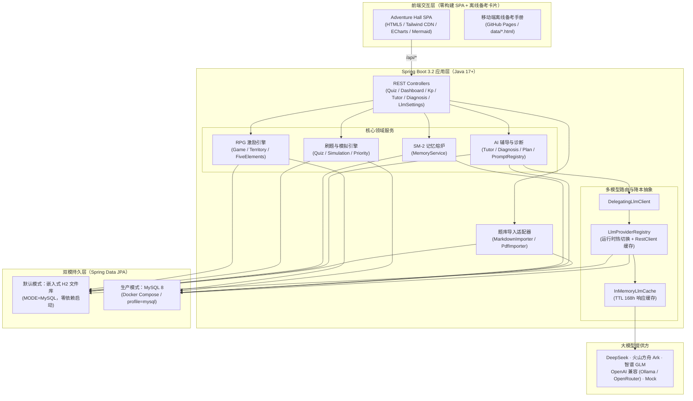

<div align="center">

# ⚔️ Study Hub · 软考系统架构设计师备考指挥中心

**一款助作者一次通关「软考系统架构设计师」的 AI + RPG 全栈备考系统 & 零门槛开源在线备考手册**

[](https://github.com/Tian-Zhen-Yin/study_hub/actions/workflows/ci.yml)
[](https://tian-zhen-yin.github.io/study_hub/)
[](https://adoptium.net/)
[](https://spring.io/projects/spring-boot)
[](LICENSE)

[**📘 零门槛在线备考手册（免安装直读）**](https://tian-zhen-yin.github.io/study_hub/) ·
[**🚀 1 分钟本地启动**](#-1-分钟极速启动) ·
[**🤖 接入 DeepSeek / Ollama**](#-大模型配置支持网页热切换) ·
[**📥 导入自定义题库**](docs/question-bank-format.md) ·
[**💬 提交反馈 / 共建**](https://github.com/Tian-Zhen-Yin/study_hub/issues)

</div>

---

## ✨ 为什么做这个项目？

备考**软考高级·系统架构设计师**时，常见三大痛点：
1. **刷题枯燥难坚持**：缺少正反馈，错题刷完就忘，不知道自己真正薄弱在哪个知识域。
2. **机考论文痛点突出**：机考输入框有硬字数限制（摘要 ≤ 300 字符、正文 ≤ 2500 字符），且第 2 问从“列举型”全面转向“组成 + 协同型”，背模板极易踩雷。
3. **备考资料碎片化**：综合知识、案例分析、论文范文、Redis/架构高频专题散落在各种 PDF 里，手机通勤很难翻看。

于是我顺手用 **Spring Boot 3 + 多模型 AI 导师 + SM-2 间隔重复 + RPG 游戏化** 搭建了 **Study Hub**，并打磨了一套覆盖三科的实战冲刺手册。**现在已顺利通关，将整套系统与原创备考手册全部开源**，希望能帮更多考友少走弯路、一把上岸！

---

## 🎯 两种打开方式（双轨设计）

### 方式一：📘 零门槛在线备考手册（适合所有考友，手机/电脑点开即用）

无需安装任何环境，直接访问 👉 **[https://tian-zhen-yin.github.io/study_hub/](https://tian-zhen-yin.github.io/study_hub/)**（支持夜间模式、字号缩放、进度本地保存与自定义考试倒计时）：

| 模块 | 页面 | 核心内容 |
| :--- | :--- | :--- |
| **✍️ 论文武器库** | [论文冲刺总集](https://tian-zhen-yin.github.io/study_hub/sprint.html) · [8 篇硬限范文](https://tian-zhen-yin.github.io/study_hub/essays.html) · [移动端背诵卡](https://tian-zhen-yin.github.io/study_hub/recite.html) · [六段式骨架](https://tian-zhen-yin.github.io/study_hub/backbone.html) · [15 服务架构图](https://tian-zhen-yin.github.io/study_hub/arch.html) | 唯一项目事实卡口径、摘要 ≤300 / 正文 ≤2500 机考裁剪终稿、17 张核心理论卡、反 AI 模板护城河细节 |
| **🧩 案例分析** | [案例高频 34 卡](https://tian-zhen-yin.github.io/study_hub/case-drills.html) · [Redis 专项精练](https://tian-zhen-yin.github.io/study_hub/redis-drill.html) · [案例考点脑图](https://tian-zhen-yin.github.io/study_hub/case-mindmap.html) | 质量属性效用树、ATAM 权衡分析、缓存击穿/穿透/雪崩对比、主从同步与微服务治理套路 |
| **📚 综合与冲刺** | [核心高频考点 ★5](https://tian-zhen-yin.github.io/study_hub/core-knowledge.html) · [选择题全景脑图](https://tian-zhen-yin.github.io/study_hub/arch-mindmap.html) · [考前一小时清单](https://tian-zhen-yin.github.io/study_hub/final-hour.html) | 大纲五星级速记卡片、交互式全书脑图、单页可打印考前 60 分钟极速核查清单 |

---

### 方式二：⚔️ 自部署 AI + RPG 全栈刷题系统（开箱即用，支持零依赖 H2 & Docker）

| 核心能力 | 说明 |
| :--- | :--- |
| **🎮 RPG 游戏化备考大厅** | 血量 HP / 经验 EXP / 金币 / 等级称号 / 连胜 Streak / 领地攻略 / 五行能力雷达图，把枯燥刷题变成通关打怪 |
| **🤖 AI 错题导师 & 弱点诊断** | 错题自动分析错误类型（`ErrorTag`）、命中历史错因提醒、按周期生成结构化弱点诊断报告与学习计划 |
| **🔌 多大模型运行时热切换** | 前端「AI 模型」页支持多 Key 管理与一键连通测试：支持 **DeepSeek、火山方舟 Ark、智谱 GLM、通用 OpenAI 兼容协议（本地 Ollama 免 Key / OpenRouter / 硅基流动 / 通义千问）及 Mock 模式** |
| **🔥 记忆熔炉（SM-2 算法）** | 基于 SuperMemo-2 间隔重复算法自动排期复习，针对遗忘曲线精准巩固错题 |
| **🕸️ 知识图谱 & 全真模拟** | 交互式 ECharts 考点关系图谱 + 综合知识/案例分析（小问制）/论文三科模拟，首次启动内置「精品示例数据包」开箱即玩 |
| **⚡ 双模持久层** | 默认内置 **H2 文件库**（单 Jar 零依赖启动），同时提供 **MySQL 8 + Docker Compose** 一键生产编排 |

---

## 🏗️ 系统架构设计



---

## 🚀 1 分钟极速启动

### 方式 A：单 Jar 零依赖启动（推荐个人快速体验，无需安装 MySQL）

前置要求：**JDK 17+**、**Maven 3.8+**（默认使用内置 H2 文件库 `./data/studyhub.mv.db` + 内置示例题库与知识图谱 + Mock AI，开箱即用）：

```bash
git clone https://github.com/Tian-Zhen-Yin/study_hub.git
cd study_hub

# macOS / Linux（首次自动构建并启动）
./scripts/start.sh

# Windows
scripts\start.bat
```

启动后浏览器访问：**`http://localhost:8080`**

> 点击页面底部状态栏的 **`距考试 XX 天 ✎`** 即可自定义你的目标考试日期。

---

### 方式 B：Docker Compose 一键部署（推荐长期使用，含 MySQL 8）

```bash
git clone https://github.com/Tian-Zhen-Yin/study_hub.git
cd study_hub

cp .env.example .env
# 按需修改 .env 中的数据库密码与大模型 API Key（不改也可先用 Mock 模式启动）

docker compose up -d
```

启动后访问：**`http://localhost:8080`**（可通过 `SERVER_PORT` 修改映射端口）。

---

### 方式 C：源码开发模式

```bash
# 默认 H2 零依赖模式
mvn spring-boot:run

# 切换本地 MySQL 8
SPRING_PROFILES_ACTIVE=mysql DB_PASSWORD=你的密码 mvn spring-boot:run

# 如需注入演示作答历史与 Lv.3 游戏状态（用于预览数据图表）
MOCK_ENABLED=true mvn spring-boot:run
```

---

## 🤖 大模型配置（支持网页热切换）

首次启动默认激活 **Mock 模式**（不消耗 Token 即可完整走通界面与流程）。接入真实 AI 有两种方式：

1. **网页端可视化配置（推荐）**：进入侧边栏 **「系统 → AI 模型」**，填写 API Key 或 Base URL，点击 **「测试」** 验证连通后点击 **「设为生效」**，**无需重启服务**。
2. **环境变量启动注入**（详见 [.env.example](.env.example)）：

```bash
# 接入 DeepSeek
LLM_PROVIDER=deepseek DEEPSEEK_API_KEY=sk-xxx ./scripts/start.sh

# 接入本地 Ollama（完全免费，无需 API Key！）
LLM_PROVIDER=openai_compat \
OPENAI_BASE_URL=http://localhost:11434/v1 \
OPENAI_MODEL=qwen2.5:7b \
./scripts/start.sh
```

> 支持所有兼容 OpenAI Chat Completions 协议的服务（Ollama、OpenRouter、硅基流动、通义千问 DashScope、OpenAI 官方等）。

---

## 📁 目录结构

```text
study_hub/
├── src/
│   ├── main/java/com/studyhub/
│   │   ├── ai/            # 多模型客户端抽象、路由注册表、Prompt 与缓存
│   │   ├── adapter/       # Markdown / PDF 题库导入适配器
│   │   ├── config/        # StarterPack 示例数据与知识图谱播种、CORS 配置
│   │   ├── controller/    # REST API 控制器
│   │   ├── service/       # RPG / 刷题 / SM-2 / AI 导师 / 弱点诊断服务
│   │   ├── entity/        # JPA 实体（兼容 H2 & MySQL 8）
│   │   └── repository/    # 数据访问层
│   ├── main/resources/
│   │   ├── application.yml         # 默认 H2 零依赖配置
│   │   ├── application-mysql.yml   # MySQL 8 Profile 配置
│   │   ├── prompts/                # AI 导师/诊断/计划 Prompt 模板
│   │   └── static/                 # 精简运行态 SPA 前端
│   └── test/              # 单元测试 & H2 端到端冒烟集成测试
├── data/
│   ├── papers/            # 原创论文模板、6段式骨架、机考硬限范文 Markdown
│   └── *.html             # 11 套移动端离线备考手册页面（同步部署至 GitHub Pages）
├── docs-site/             # GitHub Pages 在线备考手册门户首页
├── docs/                  # 题库导入规范与系统设计文档
├── examples/              # 标准化 Markdown 题库导入示例
├── scripts/               # 跨平台启动脚本与题库解析工具
├── Dockerfile             # 多阶段构建镜像
└── docker-compose.yml     # App + MySQL 8 一键编排
```

---

## 📥 导入你的个人题库

系统内置了 25 道高频精选选择题 + 4 道案例/论文种子题 + 17 个核心考点图谱。如需导入自己的整理题库，请查看：

- 📖 **[标准化题库导入指南（docs/question-bank-format.md）](docs/question-bank-format.md)**
- 📄 **[示例题库文件（examples/sample-bank/10-architecture-styles.md）](examples/sample-bank/10-architecture-styles.md)**

---

## 🗺️ 开源路线图（Roadmap）

- **v1.0（当前版本）**
  - [x] 双轨发布：GitHub Pages 零门槛在线备考手册 + 自部署 AI/RPG 全栈系统
  - [x] 内置 H2 文件库零依赖启动 + Docker Compose（MySQL 8）一键编排
  - [x] 通用 OpenAI 兼容协议（支持本地 Ollama 免 Key 接入）
  - [x] 精品 StarterPack 冷启动数据包（含示例题库 + 知识图谱）
  - [x] GitHub Actions 自动 CI 测试 + GitHub Pages 自动构建发布
- **v1.1（规划中 · 欢迎 PR！）**
  - [ ] 前端模块化重构：将 `shared/pages.js` 按页面拆分为原生 ES Modules
  - [ ] 补齐核心领域服务（SM-2、RPG、Diagnosis、LlmRegistry）单元测试覆盖
  - [ ] 学习记录 JSON 导入/导出（支持跨设备备份迁移）
  - [ ] AI 论文机考批改模式（自动检测摘要 ≤300 / 正文 ≤2500 字数硬限并按四维度打分）

---

## ⚠️ 合规与免责声明

- 本项目为作者备考软考系统架构设计师期间自行开发的学习工具与原创备考笔记汇总，**不内置任何受版权保护的商业题库或培训机构付费原题**。
- 当前版本定位为**个人本地/私有环境自部署学习应用**（未内置多用户鉴权）；若部署在公网服务器，建议在 Nginx/Caddy 反向代理层开启 Basic Auth 或 IP 白名单访问控制。
- 如发现内容存在疏漏、错别字或潜在版权争议，欢迎提交 [Issue](https://github.com/Tian-Zhen-Yin/study_hub/issues) 告知，我会第一时间核查处理。

---

## 🤝 参与贡献 & 支持项目

欢迎所有软考考友与技术同行一起完善这个项目！你可以：
- 给仓库点一个 **⭐ Star**，让更多备考架构师的朋友看到这份免费手册；
- 在 [Issues](https://github.com/Tian-Zhen-Yin/study_hub/issues) 分享你的备考踩坑、功能建议或提 Bug；
- 参考 [CONTRIBUTING.md](CONTRIBUTING.md) 提交 PR（代码优化、原创高质量解析、论文/案例纠错都非常欢迎）。

本项目基于 [Apache License 2.0](LICENSE) 协议开源。祝你备考顺利，一次通关！🎉
