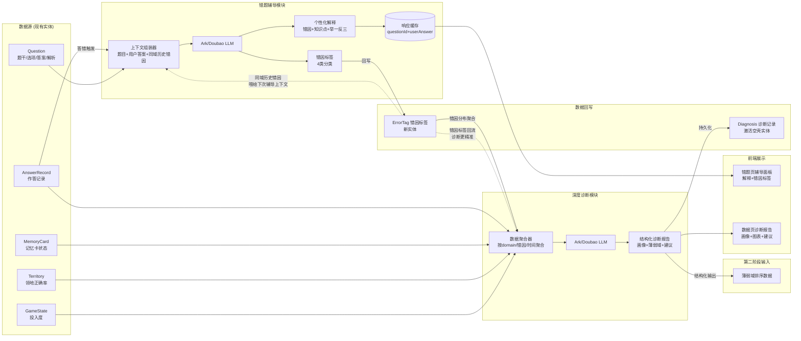
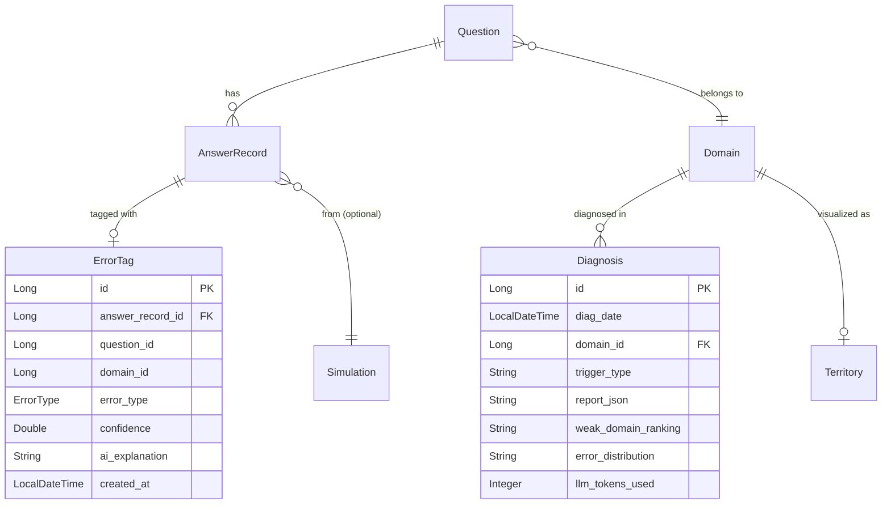
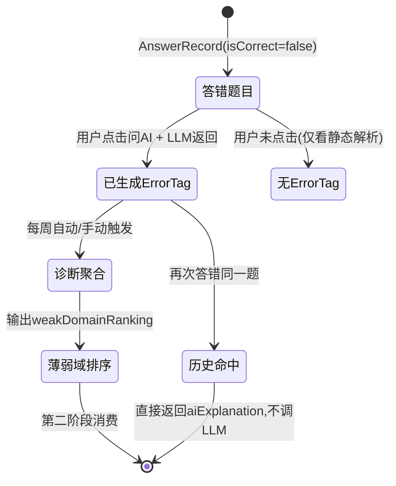

# AI 错题辅导与深度诊断 - 设计文档

- **日期**: 2026-08-05
- **项目**: study_hub (软考架构师备考工具)
- **阶段**: 第一阶段 (路线 C: 自适应学习闭环)
- **状态**: 待评审

---

## 1. 背景与目标

### 1.1 现状

study_hub 是单用户软考架构师备考工具 (Spring Boot 3.2 + Vue 3 CDN + MySQL)。已实现题库管理、7 种刷题模式、SM-2 间隔复习、RPG 游戏化 (等级/连击/Boss 战/领地)、进度导入导出。

审查发现的痛点:
1. **完全无真正 AI 集成** - `ProgressService.generateDiagnosis()` 仅返回 4 条静态中文指令,连学习数据都未输出
2. **错题反馈是静态的** - 答错只显示预设解析文本,无法针对性解释
3. **掌握度不清** - 仅正确率统计,无错因分类,无深度诊断
4. **5 个实体是空壳** - `Diagnosis`/`Essay`/`Simulation`/`StudyLog`/`WeeklyTask` 仅有实体类,无 API 与 UI

### 1.2 目标

本设计是"自适应学习闭环"(路线 C)的第一阶段,聚焦两个最高频痛点:

- **错题辅导**: 答错后一键召唤 AI,给出个性化解释 + 错因标签
- **深度诊断**: 基于作答数据 + 错因分布生成结构化诊断报告,支持每周自动生成

两个功能串成飞轮: 错题辅导产出错因标签 -> 标签回写持久化 -> 深度诊断聚合错因分布 -> 输出薄弱域排序 -> 供第二阶段 AI 学习规划消费。

### 1.3 非目标 (本阶段不做)

- 多轮追问对话 (聚焦单次精准解释,避免复杂度爆炸)
- AI 学习规划 (第二阶段)
- 案例分析/论文题 AI 评判 (第三阶段)
- 账号认证与云端同步
- Redis 等分布式缓存 (单用户场景用进程内 LRU 即可)

---

## 2. 数据流转

### 2.1 数据流转图



### 2.2 三条关键流

**流 1 - 错题辅导 (高频)**
- 触发: 用户答错题后点击"问 AI"
- 输入: 题目本体 + 用户错误答案 + 同知识域历史错因标签
- 输出: 个性化解释 (给用户) + 错因标签 (给系统)
- 缓存: 相同 (questionId, userAnswer) 命中缓存省 token

**流 2 - 错因标签回写 (飞轮齿轮)**
- 错因标签持久化到新 `ErrorTag` 实体
- 4 类标签: `CONCEPT_MISS` (概念不会) / `MISREAD` (审题失误) / `MEMORY_CONFUSE` (记忆混淆) / `CALC_ERROR` (计算错误)
- 与现有 `generateDiagnosis()` 静态指令的四个分类完全对齐,把"应当区分"变成"已自动区分"
- 让"答错 -> 辅导 -> 标签 -> 诊断"形成闭环

**流 3 - 深度诊断 (低频高价值)**
- 触发: 用户主动点击 + 每周日 22:00 自动生成
- 输入: 作答记录 + 记忆卡状态 + 领地正确率 + 错因分布 + 游戏投入度
- 输出: 学习者画像 + 薄弱知识域排序 + 错因占比 + 下周建议
- 持久化到 `Diagnosis` 实体 (激活空壳)
- 输出结构化 `weakDomainRanking` 供第二阶段 AI 规划直接消费

### 2.3 设计要点

1. 两个 LLM 调用共用同一套基础设施 (统一 `LlmClient` 抽象)
2. 错题辅导的错因标签是飞轮齿轮 - 没有它诊断只能看正确率,有了它诊断能说"数据库这块 60% 是概念不会"
3. 第二阶段接口预留: 诊断报告输出结构化 `weakDomainRanking` 数组 (非自然语言),方便第二阶段直接消费

---

## 3. 架构与 LLM 层

### 3.1 分层架构

遵循现有 `entity -> repository -> service -> controller -> dto` 模式,新增 AI 相关包:

```
com.studyhub/
├── adapter/          (现有: PdfImporter 等)
├── ai/               (新增)
│   ├── LlmClient.java              <- 统一抽象接口
│   ├── LlmRequest.java             <- 请求 DTO (prompt, temperature, maxTokens)
│   ├── LlmResponse.java            <- 响应 DTO (content, tokensUsed, cached)
│   ├── ArkLlmClient.java           <- 火山引擎 Ark 实现
│   ├── PromptTemplate.java         <- 模板加载与渲染
│   ├── PromptRegistry.java         <- 模板注册中心
│   ├── LlmCache.java               <- 响应缓存抽象
│   └── InMemoryLlmCache.java       <- 进程内 LRU 缓存实现
├── config/
│   ├── ArkConfig.java              (新增: Ark API key/endpoint 配置)
│   └── SchedulingConfig.java       (新增: 启用 @Scheduled)
├── entity/
│   ├── ErrorTag.java               (新增)
│   └── Diagnosis.java              (现有, 激活)
├── repository/
│   ├── ErrorTagRepository.java     (新增)
│   └── DiagnosisRepository.java    (新增)
├── service/
│   ├── TutorService.java           (新增: 错题辅导)
│   ├── DiagnosisService.java       (新增: 深度诊断)
│   └── ... (现有)
├── controller/
│   ├── TutorController.java        (新增)
│   ├── DiagnosisController.java    (新增)
│   └── GlobalExceptionHandler.java (新增: 统一异常处理)
└── dto/
    ├── TutorRequest.java           (新增)
    ├── TutorResponse.java          (新增)
    ├── DiagnosisReport.java        (新增, 结构化报告)
    └── ErrorTagDTO.java            (新增)
```

`ai/` 包是唯一的横切关注点,TutorService 和 DiagnosisService 都依赖它。新增组件按现有包结构落位,不破坏既有分层。

### 3.2 LLM 抽象层

设计原则: **轻量但可扩展** - 单用户系统不需要中台,但要为缓存、降级、成本观测留口子。

#### `LlmClient` 接口

```java
public interface LlmClient {
    LlmResponse chat(LlmRequest request);

    interface LlmRequest {
        String systemPrompt();
        String userPrompt();
        Double temperature();
        Integer maxTokens();
    }

    interface LlmResponse {
        String content();
        int tokensUsed();
        boolean cached();
    }
}
```

设计理由:
- **system + user 双 prompt**: system 放角色设定 ("你是软考架构师辅导老师"),user 放具体任务。LLM 应用标准范式,便于复用 system prompt
- **temperature/maxTokens 暴露在接口**: 辅导和诊断对创造性要求不同 (诊断要稳定、辅导可适度发散),调用方按需设置
- **tokensUsed 字段**: 成本观测的最低要求

#### `ArkLlmClient` 实现

```java
@Component
@ConditionalOnProperty(name = "studyhub.llm.provider", havingValue = "ark")
public class ArkLlmClient implements LlmClient {
    private final ArkService arkService;  // 火山引擎 SDK
    private final LlmCache cache;

    public LlmResponse chat(LlmRequest req) {
        String cacheKey = buildKey(req);
        Optional<LlmResponse> hit = cache.get(cacheKey);
        if (hit.isPresent()) return hit.get();

        // 调用 Ark SDK, 超时 30s
        String content = arkService.completions(...);
        LlmResponse resp = new LlmResponse(content, tokens, false);
        cache.put(cacheKey, resp);
        return resp;
    }
}
```

- `@ConditionalOnProperty`: 通过 `studyhub.llm.provider=ark` 切换实现。未来想换 OpenAI 只需新增 `OpenAiLlmClient` 并改配置,不动业务代码
- 缓存前置: 先查缓存再调 LLM,省钱省时

### 3.3 LLM 缓存 (InMemory LRU)

采用进程内 LRU 缓存,与单用户本地应用场景一致,零额外依赖。

**`LlmCache` 抽象**:

```java
public interface LlmCache {
    Optional<LlmResponse> get(String key);
    void put(String key, LlmResponse response);
    void invalidate(String key);
    void clear();
}
```

**`InMemoryLlmCache` 实现要点**:
- 基于 `ConcurrentHashMap` + `LinkedHashMap` (accessOrder=true) 实现 LRU 淘汰
- 最大容量 500 条 (可配置 `studyhub.llm.cache.max-size`)
- TTL 168 小时 (7 天,可配置 `studyhub.llm.cache.ttl-hours`) - 题目缓存一周后失效,允许重新生成
- 线程安全: 读写加锁或使用 `ConcurrentHashMap` 原子操作
- 与 `ErrorTag` 持久化缓存的关系: ErrorTag 是永久持久化 (同一题永远不再调 LLM),LlmCache 兜底处理临时场景。两者都保留,三层防线 (ErrorTag -> LlmCache -> LLM 调用) 确保 token 消耗最低

**缓存 key 构造规则**:
```
key = "tutor:" + questionId + ":" + sha256(userAnswer + systemPrompt + userPrompt)
```
- 前缀 `tutor:` 区分功能 (未来诊断用 `diagnosis:` 前缀,但诊断不缓存)
- questionId 便于排查
- sha256 避免长 prompt 拼接导致 key 过长

### 3.4 Prompt 模板管理

Prompt 是 AI 功能的"业务逻辑",不该散落在 Java 字符串拼接里。

#### 模板存放

```
src/main/resources/prompts/
├── tutor-system.md          <- 辅导老师角色设定
├── tutor-explain.md         <- 错题解释模板 (含占位符)
└── diagnosis-report.md      <- 诊断报告模板
```

用 `.md` 文件而非 Java 常量的理由:
- Prompt 需要反复迭代调优,放文件里改了不必重新编译
- 长文本 prompt 在 Java 字符串里可读性极差
- 支持 Git 版本追踪 prompt 演进

#### `PromptRegistry` 渲染

```java
@Component
public class PromptRegistry {
    private final Map<String, String> templates = new HashMap<>();

    @PostConstruct
    public void load() {
        templates.put("tutor-explain", loadResource("prompts/tutor-explain.md"));
        // ...
    }

    public String render(String name, Map<String, Object> vars) {
        String tpl = templates.get(name);
        // 简单占位符替换: {{question}} {{userAnswer}} {{historyTags}}
        return renderTemplate(tpl, vars);
    }
}
```

不引入 Thymeleaf/Freemarker - 用最简单的 `{{var}}` 占位符替换,YAGNI。模板引擎对 prompt 场景过重。

### 3.5 两个核心 Service

#### `TutorService` (错题辅导)

```java
@Service
public class TutorService {
    private final LlmClient llm;
    private final PromptRegistry prompts;
    private final ErrorTagRepository tagRepo;
    private final AnswerRecordRepository recordRepo;

    @Transactional
    public TutorResponse explain(AnswerRecord record) {
        // 1. 组装上下文 (用 domainId 查同域历史错因)
        Long domainId = record.getQuestion().getDomainId();
        List<String> historyTags = tagRepo.findRecentTagsByDomain(domainId, 10);

        // 2. 渲染 prompt
        Map<String, Object> vars = Map.of(
            "question", record.getQuestion().getStem(),
            "userAnswer", record.getUserAnswer(),
            "correctAnswer", record.getQuestion().getAnswer(),
            "analysis", record.getQuestion().getAnalysis(),
            "historyTags", String.join("、", historyTags)
        );
        String system = prompts.render("tutor-system", Map.of());
        String user = prompts.render("tutor-explain", vars);

        // 3. 调 LLM (要求返回 JSON: {explanation, errorTag, confidence})
        LlmResponse resp = llm.chat(new LlmRequest(system, user, 0.7, 800));

        // 4. 解析 + 回写 ErrorTag
        TutorResult result = TutorResultParser.parse(resp.content());
        ErrorTag tag = ErrorTag.builder()
            .answerRecord(record)
            .questionId(record.getQuestion().getId())
            .domainId(domainId)
            .errorType(result.errorType())
            .confidence(result.confidence())
            .aiExplanation(result.explanation())
            .createdAt(LocalDateTime.now())
            .build();
        tagRepo.save(tag);

        return new TutorResponse(result.explanation(), result.errorType(),
                                 result.confidence(), resp.tokensUsed(), false);
    }
}
```

第一阶段聚焦单次精准解释,不支持多轮追问。`TutorRequest` 不含 `followUp` 字段 (留到后续阶段)。

#### `DiagnosisService` (深度诊断)

```java
@Service
public class DiagnosisService {
    private final LlmClient llm;
    private final PromptRegistry prompts;
    private final AnswerRecordRepository recordRepo;
    private final ErrorTagRepository tagRepo;
    private final MemoryService memoryService;
    private final GameService gameService;
    private final DiagnosisRepository diagRepo;

    // 手动触发
    public DiagnosisReport generate() {
        return doGenerate("manual");
    }

    // 每周自动触发
    @Scheduled(cron = "0 0 22 ? * SUN")  // 每周日 22:00
    public void weeklyAutoGenerate() {
        if (!hasEnoughData()) return;  // 数据不足跳过
        DiagnosisReport report = doGenerate("auto");
        diagRepo.save(report.toEntity());
    }

    // lazy 补偿: 应用启动时检查本周是否已生成
    @EventListener(ApplicationReadyEvent.class)
    public void compensateIfMissed() {
        if (!hasEnoughData()) return;
        LocalDate lastDiagDate = diagRepo.findLatestDiagDate();
        if (isThisWeek(lastDiagDate)) return;
        if (LocalDate.now().getDayOfWeek().getValue() >= 7) {  // 周日及以后
            DiagnosisReport report = doGenerate("auto");
            diagRepo.save(report.toEntity());
        }
    }

    private DiagnosisReport doGenerate(String trigger) {
        // 1. 聚合数据 (7天窗口 + 全量)
        DiagnosisContext ctx = aggregateContext();

        // 2. 渲染 prompt
        String user = prompts.render("diagnosis-report", ctx.toVars());

        // 3. 调 LLM (temperature=0.3 求稳定)
        LlmResponse resp = llm.chat(new LlmRequest(system, user, 0.3, 2000));

        // 4. 解析结构化报告
        DiagnosisReport report = parseReport(resp.content());
        report.setTrigger(trigger);  // "manual" / "auto"
        return report;
    }
}
```

#### 两个 Service 对 LLM 的使用对比

| 维度 | TutorService | DiagnosisService |
|------|-------------|-----------------|
| 调用频率 | 高 (每次答错) | 低 (每周 1 次 + 手动) |
| temperature | 0.7 (适度发散,解释更生动) | 0.3 (求稳定,诊断要一致) |
| maxTokens | 800 | 2000 |
| 缓存策略 | 按 (questionId, userAnswer) 缓存 | 不缓存 (每次数据不同) |
| 输出格式 | JSON (explanation + errorTag + confidence) | JSON (画像 + 薄弱域 + 建议) |
| 响应延迟容忍 | <5s (用户等着) | <30s (后台可慢) |

### 3.6 LLM 输出格式

强制 JSON 输出 (Doubao 支持 `response_format: json_object`),便于 Java 端解析与回写 ErrorTag。

**错题辅导 LLM 返回 JSON schema**:
```json
{
  "explanation": "你选了B,但正确答案是A。这里考查的是...",
  "errorType": "CONCEPT_MISS",
  "confidence": 0.85
}
```

**诊断报告 LLM 返回 JSON schema**:
```json
{
  "learnerProfile": {
    "summary": "中级架构师,累计342题,正确率68%,连续学习12天",
    "strengths": ["数据库技术", "设计模式"],
    "weaknesses": ["计算机网络"]
  },
  "weakDomains": [
    {"domainId": 4, "domainName": "计算机网络", "accuracy": 0.42, "errorCount": 28},
    {"domainId": 2, "domainName": "操作系统", "accuracy": 0.55, "errorCount": 19}
  ],
  "errorDistribution": {
    "CONCEPT_MISS": 0.58, "MEMORY_CONFUSE": 0.22,
    "MISREAD": 0.12, "CALC_ERROR": 0.08
  },
  "weeklyAdvice": "本周计算机网络薄弱集中..."
}
```

注: `weakDomainRanking` 数组由 Java 端从 `weakDomains` 提取 domainId 排序生成,不依赖 LLM 输出,保证机器消费接口的可靠性。

### 3.7 配置项

`application.yml` 新增:

```yaml
studyhub:
  llm:
    provider: ark
    cache:
      enabled: true
      max-size: 500
      ttl-hours: 168        # 7天,题目缓存一周
  ark:
    api-key: ${ARK_API_KEY}
    base-url: https://ark.cn-beijing.volces.com/api/v3
    model: doubao-pro-32k   # 长上下文 + 中文优化
    timeout-seconds: 30
  diagnosis:
    auto-generate: true
    cron: "0 0 22 ? * SUN"
    min-records: 20         # 少于20条作答不生成
```

所有敏感配置用环境变量 (`${ARK_API_KEY}`),不硬编码。

### 3.8 每周自动诊断的补偿机制

| 方式 | 实现 | 问题 |
|------|------|------|
| A. 纯 `@Scheduled` | 周日 22:00 固定执行 | 用户关机/应用没跑就漏触发 |
| B. `@Scheduled` + lazy 补偿 (采用) | 定时兜底 + 启动检查"本周是否已生成" | 最可靠,符合单用户本地应用场景 |
| C. Quartz 持久化 | 引入 Quartz 框架 + DB 存储 | 过度工程化 |

方式 B 的补偿逻辑: 在 `ApplicationReadyEvent` 里检查"最近一次 Diagnosis 是否在本周",若不是且今天 >= 周日,则补生成。即使周日没开机,周一打开也会补上。

### 3.9 与现有架构的集成点

- **TutorService**: 新增独立 `TutorController` 暴露 `POST /api/tutor/explain`,前端答错后单独请求。不与 `QuizController` 答题接口耦合,避免拖慢判题响应
- **DiagnosisService**: 替换现有 `ProgressService.generateDiagnosis()` 的静态实现,原方法标记 `@Deprecated`,下个版本移除
- **ErrorTag**: 不侵入 `AnswerRecord`,通过 `answerRecordId` 外键关联
- **Diagnosis**: 实体激活,新增 `triggerType`/`reportJson`/`weakDomainRanking`/`errorDistribution`/`llmTokensUsed` 字段
- **GlobalExceptionHandler**: 顺带补一个轻量全局异常处理器,统一返回 `{code, message}` 格式

---

## 4. 组件与数据模型

### 4.1 `ErrorTag` 实体 (新增)

错因标签是飞轮的关键齿轮。每条答错记录对应一个错因标签。

```java
@Entity
@Table(name = "error_tags",
       indexes = {
           @Index(name = "idx_errortag_record", columnList = "answer_record_id"),
           @Index(name = "idx_errortag_domain_type", columnList = "domain_id,error_type")
       })
@Data @Builder @NoArgsConstructor @AllArgsConstructor
public class ErrorTag {
    @Id @GeneratedValue(strategy = GenerationType.IDENTITY)
    private Long id;

    @ManyToOne(fetch = FetchType.LAZY)
    @JoinColumn(name = "answer_record_id", nullable = false)
    private AnswerRecord answerRecord;          // 关联作答记录

    @Column(name = "question_id", nullable = false)
    private Long questionId;                     // 冗余,便于按题聚合

    @Column(name = "domain_id", nullable = false)
    private Long domainId;                       // 冗余,便于按域聚合诊断

    @Enumerated(EnumType.STRING)
    @Column(name = "error_type", nullable = false, length = 16)
    private ErrorType errorType;                 // 4类错因

    @Column(name = "confidence", nullable = false)
    private Double confidence;                   // LLM置信度 0.0-1.0

    @Column(name = "ai_explanation", length = 2000)
    private String aiExplanation;                // 本次辅导解释(冗余,避免重复调LLM)

    @Column(name = "created_at", nullable = false)
    private LocalDateTime createdAt;
}
```

关键设计决策:
1. **`questionId`/`domainId` 冗余字段**: 虽能通过 `answerRecord -> question -> domain` 联查,但诊断聚合高频按域统计错因分布,冗余字段避免 N+1 查询,空间换时间
2. **`aiExplanation` 冗余存储**: 把辅导解释也存一份在 ErrorTag 里,下次答错同一题可直接从 ErrorTag 取历史解释,连缓存都不用查,进一步省 token
3. **`confidence` 字段**: 低置信度 (<0.6) 的标签在诊断聚合时降权,避免 LLM 误判污染画像
4. **`errorType` 用枚举**: 4 类与现有 `generateDiagnosis()` 静态指令的四个分类完全对齐

**`ErrorType` 枚举**:

```java
public enum ErrorType {
    CONCEPT_MISS("概念不会"),
    MISREAD("审题失误"),
    MEMORY_CONFUSE("记忆混淆"),
    CALC_ERROR("计算错误");

    private final String label;
    // ...
}
```

### 4.2 `Diagnosis` 实体 (激活现有空壳)

现有 `Diagnosis` 有 `diagDate, subject, domain, score, total, weaknesses(JSON), notes` 字段。新增字段:

```java
// 现有字段保留,新增:
@Column(name = "trigger_type", length = 10)
private String triggerType;                    // "manual" / "auto"

@Column(name = "report_json", columnDefinition = "MEDIUMTEXT")
private String reportJson;                     // 完整结构化报告JSON

@Column(name = "weak_domain_ranking", length = 1000)
private String weakDomainRanking;              // 薄弱域排序JSON,供第二阶段消费

@Column(name = "error_distribution", length = 500)
private String errorDistribution;              // 错因分布JSON

@Column(name = "llm_tokens_used")
private Integer llmTokensUsed;

@Column(name = "created_at", nullable = false)
private LocalDateTime createdAt;
```

为什么把 `reportJson` 整体存 MEDIUMTEXT 而非拆多表:
- 诊断报告是"快照式"只读数据,不需要按字段查询
- 一份完整报告保留历史纵向对比能力 (上周 vs 本周)
- `weakDomainRanking` 单独提出来是因为第二阶段 AI 规划要直接消费它,单独字段便于查询

### 4.3 实体关系



关键关系: `AnswerRecord (1) --< ErrorTag (0..1)` - 一条作答记录最多一个错因标签 (仅在答错且触发辅导时生成)。

### 4.4 API 端点

#### 错题辅导 API

| 方法 | 路径 | 说明 |
|------|------|------|
| `POST` | `/api/tutor/explain` | 请求 AI 辅导 (传 answerRecordId,内部自动处理历史命中与缓存) |

**`POST /api/tutor/explain` 请求/响应**:

```json
// 请求
{ "answerRecordId": 123 }

// 响应 (200)
{
  "explanation": "你选了B,但正确答案是A。这里考查的是...",
  "errorType": "CONCEPT_MISS",
  "errorTypeLabel": "概念不会",
  "confidence": 0.85,
  "cached": false,
  "degraded": false,
  "tokensUsed": 320
}
```

只传 `answerRecordId`: 题干、用户答案、正确答案、解析都能从 AnswerRecord 关联拿到,前端不用重复传,减少数据冗余和不一致风险。

降级响应 (`degraded=true`):
```json
{
  "explanation": "<静态解析文本>",
  "errorType": null,
  "errorTypeLabel": null,
  "confidence": 0.0,
  "cached": false,
  "degraded": true,
  "tokensUsed": 0
}
```

#### 深度诊断 API

| 方法 | 路径 | 说明 |
|------|------|------|
| `POST` | `/api/diagnosis/generate` | 手动触发生成 (同步返回报告) |
| `GET` | `/api/diagnosis/latest` | 获取最近一次诊断报告 |
| `GET` | `/api/diagnosis/history` | 获取历史诊断列表 (纵向对比) |

**`GET /api/diagnosis/latest` 响应**:

```json
{
  "id": 45,
  "diagDate": "2026-08-09",
  "triggerType": "auto",
  "learnerProfile": {
    "level": 3,
    "title": "中级架构师",
    "totalAnswered": 342,
    "overallAccuracy": 0.68,
    "loginStreak": 12
  },
  "weakDomains": [
    {"domainId": 4, "domainName": "计算机网络", "accuracy": 0.42, "errorCount": 28},
    {"domainId": 2, "domainName": "操作系统", "accuracy": 0.55, "errorCount": 19}
  ],
  "errorDistribution": {
    "CONCEPT_MISS": 0.58, "MEMORY_CONFUSE": 0.22,
    "MISREAD": 0.12, "CALC_ERROR": 0.08
  },
  "weeklyAdvice": "本周计算机网络薄弱集中...建议每天投入1.5小时...",
  "weakDomainRanking": [4, 2, 7, 5],
  "tokensUsed": 1850
}
```

`weakDomainRanking` 用纯数组 `[4,2,7,5]` 而非对象数组: 这是给第二阶段 AI 规划的机器消费接口,越简单越好,第二阶段 `POST /api/plan/generate` 直接把这个数组当入参。

### 4.5 前端组件

遵循现有 Vue 3 CDN 组件模式,新增 2 个组件 + 改造 2 处。

#### 新增组件

```
src/main/frontend/js/components/
├── tutor-panel.js          <- 错题辅导面板
└── diagnosis-report.js     <- 诊断报告组件 (数据页用)
```

**`tutor-panel.js`**:

```javascript
export default {
  template: `
    <div class="tutor-panel" v-if="visible">
      <div class="tutor-header">
        <span class="tutor-badge">AI 辅导</span>
        <span class="error-tag" :class="errorType" v-if="errorType">{{ errorTypeLabel }}</span>
      </div>
      <div class="tutor-body" v-html="renderedExplanation"></div>
      <div class="tutor-footer">
        <span class="tokens" v-if="tokensUsed">耗 {{tokensUsed}} tokens</span>
        <button @click="$emit('close')" class="btn-close">明白了</button>
      </div>
    </div>
  `,
  props: {
    answerRecordId: Number,
    visible: Boolean
  },
  data() {
    return { explanation: '', errorType: '', errorTypeLabel: '',
             tokensUsed: 0, degraded: false, loading: false }
  },
  methods: {
    async fetchExplanation() {
      this.loading = true;
      const resp = await api.post('/api/tutor/explain',
        { answerRecordId: this.answerRecordId });
      Object.assign(this, resp);
      this.loading = false;
    }
  },
  watch: {
    visible(v) { if (v) this.fetchExplanation(); }
  }
}
```

触发时机: 在现有 `question-panel.js` 答错后,`analysis-panel` 下方显示一个"问 AI 为什么错"按钮,点击展开 `tutor-panel`。不强制弹窗 - 用户可选择只看静态解析,AI 是可选增强。

#### 改造现有组件

1. **`question-panel.js`**: 答错时新增"问 AI"按钮,点击后 emit 事件触发 `tutor-panel` 显示
2. **`data-page.js`**: 新增"AI 诊断报告"区块,替换现有的"下载 ai-diagnosis.json"静态按钮。点击"生成诊断"调用 `POST /api/diagnosis/generate`,加载态 -> 展示 `diagnosis-report` 组件

#### `diagnosis-report.js` 结构

报告分四块展示,对应响应 JSON:
- **学习者画像**: 等级/称号/累计题数/正确率/连续天数 (部分复用现有 game-hud 数据)
- **薄弱知识域**: 横向条形图,按正确率升序,标注错题数
- **错因分布**: 饼图 (4 类错因占比)
- **本周建议**: LLM 生成的自然语言文本

图表用轻量方案: Canvas 手绘 (现有旧版 `dashboard.js` 已有 Canvas 雷达图实现,可借鉴风格),不引入 ECharts/Chart.js,保持 CDN 零依赖的一致性。

### 4.6 错因标签生命周期



两个优化路径:
- **历史命中**: 同一题再次答错,先查 ErrorTag 表,命中则直接返回 `aiExplanation`,零 LLM 调用
- **缓存命中**: ErrorTag 未命中 (首次答错),查 LlmCache,命中则跳过 LLM 调用但仍回写 ErrorTag

三层防线 (ErrorTag -> LlmCache -> LLM 调用) 确保 token 消耗最低。

### 4.7 数据量与性能预估

单用户场景下的数据量评估:

| 表 | 预估行数 | 查询热点 |
|----|---------|---------|
| `error_tags` | ~500 (每错题1条) | 按 domainId+errorType 聚合 |
| `diagnosis` | ~13 (每周1条x半年) | 按时间倒序取最新 |

聚合查询优化 - 诊断时按域统计错因分布,用一条原生 SQL 避免 N+1:

```java
@Query("SELECT e.domainId, e.errorType, COUNT(e) " +
       "FROM ErrorTag e WHERE e.createdAt > :since " +
       "GROUP BY e.domainId, e.errorType")
List<Object[]> aggregateErrorDistribution(@Param("since") LocalDateTime since);
```

---

## 5. 错误处理与测试

### 5.1 失败模式与降级

AI 是增强而非必需。任何 AI 失败都不能阻塞核心刷题流程 - 用户照常能看静态解析、照常能答题。

| 失败模式 | 触发场景 | 降级策略 | 用户感知 |
|---------|---------|---------|---------|
| LLM 超时 | Ark API >30s 未响应 | 返回静态解析兜底 | "AI 辅导暂时不可用,已显示标准解析" |
| LLM 限流 (429) | 短时高频请求 | 退避重试 1 次,仍失败则降级 | 同上 + 静默记录告警日志 |
| LLM 鉴权失败 (401) | API Key 失效/欠费 | 不重试,直接降级 + 日志告警 | 同上 + 服务端日志显著标记 |
| JSON 解析失败 | LLM 返回非法 JSON | 尝试正则提取 `explanation` 字段,失败则降级 | 显示"AI 响应格式异常" |
| 错因标签缺失 | JSON 有解析但无 errorType | 默认 `CONCEPT_MISS` + confidence=0.0 | 解释正常显示,标签不阻塞 |
| 诊断数据不足 | 作答记录 <20 条 | 跳过 LLM 调用,返回提示 | "数据量不足,再答 X 题后可生成诊断" |
| 网络中断 | 本地无网络 | 快速失败降级 | 同超时 |

### 5.2 分层错误处理

#### LLM 层 (`ArkLlmClient`)

```java
public LlmResponse chat(LlmRequest req) {
    try {
        String content = arkService.completions(...);  // 带 30s 超时
        return new LlmResponse(content, tokens, false);
    } catch (ArkTimeoutException e) {
        throw new LlmUnavailableException("TIMEOUT", e);
    } catch (ArkRateLimitException e) {
        // 退避重试 1 次
        sleep(2000);
        try { return doCall(req); }
        catch (Exception e2) { throw new LlmUnavailableException("RATE_LIMIT", e2); }
    } catch (ArkAuthException e) {
        throw new LlmUnavailableException("AUTH_FAILED", e);
    }
}
```

自定义异常 `LlmUnavailableException` 携带 `reasonCode`,上层据此决定降级方式。

#### Service 层 (`TutorService`)

```java
public TutorResponse explain(AnswerRecord record) {
    // 先查 ErrorTag 历史命中 -> 零 LLM
    Optional<ErrorTag> cached = tagRepo.findByAnswerRecordId(record.getId());
    if (cached.isPresent()) {
        return TutorResponse.fromCache(cached.get());  // cached=true
    }

    try {
        LlmResponse resp = llm.chat(buildRequest(record));
        TutorResult result = TutorResultParser.parse(resp.content());
        ErrorTag tag = ErrorTag.builder()
            .answerRecord(record)
            .questionId(record.getQuestion().getId())
            .domainId(record.getQuestion().getDomainId())
            .errorType(result.errorType())
            .confidence(result.confidence())
            .aiExplanation(result.explanation())
            .createdAt(LocalDateTime.now())
            .build();
        tagRepo.save(tag);
        return new TutorResponse(result, resp.tokensUsed(), false);
    } catch (LlmUnavailableException e) {
        log.warn("LLM辅导降级 recordId={} reason={}", record.getId(), e.getReasonCode());
        return TutorResponse.fallback(record.getQuestion().getAnalysis());  // 降级静态解析
    } catch (JsonParseException e) {
        log.warn("LLM返回JSON解析失败 recordId={}", record.getId());
        return TutorResponse.fallback(record.getQuestion().getAnalysis());
    }
}
```

降级返回的 `TutorResponse` 带 `degraded=true` 标记,前端据此显示不同 UI (灰色"AI 暂不可用"而非蓝色"AI 辅导")。

#### Controller 层

```java
@PostMapping("/api/tutor/explain")
public ResponseEntity<?> explain(@RequestBody TutorRequest req) {
    AnswerRecord record = recordRepo.findById(req.getAnswerRecordId())
        .orElseThrow(() -> new ResponseStatusException(NOT_FOUND, "作答记录不存在"));
    if (record.isCorrect()) {
        return ResponseEntity.badRequest().body(Map.of("error", "该题答对,无需辅导"));
    }
    return ResponseEntity.ok(tutorService.explain(record));
}
```

`GlobalExceptionHandler` 统一异常处理,返回 `{code, message}` 格式。

### 5.3 JSON 解析的健壮性

LLM 即便指定 `response_format: json_object`,仍可能返回带 markdown 代码块包裹的 JSON。设计容错解析器:

```java
public class TutorResultParser {
    public TutorResult parse(String raw) {
        // 1. 去除 ```json ... ``` 包裹
        String json = stripCodeFence(raw);
        // 2. 标准 JSON 解析
        try {
            return objectMapper.readValue(json, TutorResult.class);
        } catch (Exception e) {
            // 3. 降级:正则提取关键字段
            String explanation = extractByRegex(json, "\"explanation\"\\s*:\\s*\"([^\"]+)\"");
            if (explanation != null) {
                return TutorResult.partial(explanation, ErrorType.CONCEPT_MISS, 0.0);
            }
            throw new JsonParseException("无法解析LLM响应", e);
        }
    }
}
```

三层解析: 去壳 -> 标准解析 -> 正则兜底。尽最大努力给用户返回有价值的解释。

### 5.4 测试策略

当前项目无任何测试。本阶段引入测试,保持轻量,聚焦 AI 逻辑的关键路径。

#### 测试分层

```
src/test/java/com/studyhub/
├── ai/
│   ├── PromptRegistryTest.java        <- 模板加载与渲染
│   ├── InMemoryLlmCacheTest.java      <- 缓存命中/淘汰/TTL
│   └── TutorResultParserTest.java     <- JSON解析容错(重点)
├── service/
│   ├── TutorServiceTest.java          <- 辅导主流程+降级(重点)
│   └── DiagnosisServiceTest.java      <- 诊断聚合+定时触发
└── adapter/
    └── LlmClientContractTest.java     <- LlmClient接口契约(抽象测试)
```

#### 关键测试用例

**`TutorResultParserTest` (最高优先级)** - LLM 输出不可控,解析必须稳:

| 用例 | 输入 | 期望 |
|------|------|------|
| 标准JSON | `{"explanation":"...","errorType":"CONCEPT_MISS","confidence":0.9}` | 正常解析 |
| 带代码块包裹 | ` ```json\n{...}\n``` ` | 去壳后解析 |
| 缺 confidence | `{"explanation":"...","errorType":"MISREAD"}` | confidence 默认 0.0 |
| 缺 errorType | `{"explanation":"..."}` | 默认 CONCEPT_MISS |
| 完全非法 | `"这是纯文本"` | 正则提取失败 -> 抛 JsonParseException |
| 字段名不同 | `{"explain":"..."}` | 正则兜底提取 |

**`TutorServiceTest`** - 验证降级逻辑:

- 应答错且LLM可用_返回辅导并回写ErrorTag
- 应同一题再次答错_命中ErrorTag不调LLM
- 应LLM超时_降级返回静态解析且degraded为true
- 应LLM返回非法JSON_降级返回静态解析
- 应答对的题请求辅导_抛出业务异常

**`DiagnosisServiceTest`** - 验证定时与数据门控:

- 应作答不足20条_跳过LLM返回数据不足提示
- 应每周自动触发_生成报告并标记trigger为auto
- 应手动触发_标记trigger为manual
- 应lazy补偿_本周未生成且今天周日_启动时补生成

#### LLM Mock 策略

测试中绝不调真实 Ark API。设计 `FakeLlmClient` 实现 `LlmClient` 接口:

```java
public class FakeLlmClient implements LlmClient {
    private Queue<LlmResponse> scriptedResponses = new LinkedList<>();
    private Queue<Exception> scriptedExceptions = new LinkedList<>();

    public void enqueueResponse(String content) { ... }
    public void enqueueTimeout() { scriptedExceptions.add(new LlmUnavailableException("TIMEOUT")); }

    public LlmResponse chat(LlmRequest req) {
        if (!scriptedExceptions.isEmpty()) throw scriptedExceptions.poll();
        return scriptedResponses.poll();
    }
}
```

通过 `LlmClient` 接口注入 Fake 实现,测试可脚本化控制 LLM 返回 (正常/超时/限流/非法JSON),覆盖所有降级路径。

#### 集成测试 (最小化)

```java
@SpringBootTest
class TutorFlowIntegrationTest {
    @MockBean LlmClient llmClient;  // Spring 上下文里替换为 Mock

    @Test
    void 完整流程_答错_请求辅导_查历史命中() {
        // 1. 答错一题
        // 2. 请求辅导 (llm mock 返回正常)
        // 3. 再次请求同题辅导 (应命中 ErrorTag, llm 不被调用)
        verify(llmClient, times(1)).chat(any());  // 只调一次
    }
}
```

### 5.5 可观测性 (轻量)

不引入 Micrometer/Prometheus (现有项目无),用最简方式观测 AI 健康:

- **日志**: 所有 LLM 调用记录 `[Tutor] recordId=X tokens=Y cached=Z degraded=W`,便于事后排查
- **`Diagnosis.llmTokensUsed` 字段**: 累计统计 token 消耗,评估成本
- **前端 tokensUsed 展示**: 每次辅导显示消耗,让用户对 AI 成本有感知

### 5.6 安全与合规

- **API Key 保护**: `ARK_API_KEY` 仅通过环境变量注入,不进 git,`application.yml` 用 `${ARK_API_KEY}` 占位
- **Prompt 注入防护**: 用户输入的题目数据来自已入库的 Question (非直接用户输入),注入风险低;但仍对题干做长度截断 (>2000 字符截断) 防止超长 prompt 攻击
- **PII**: 当前单用户无敏感个人信息传入 LLM,仅题目和作答数据,无合规风险

---

## 6. 实现顺序建议

供 writing-plans 阶段参考的任务拆分 (非最终计划):

1. **基础设施**: LlmClient 接口 + ArkLlmClient + InMemoryLlmCache + PromptRegistry + 配置项
2. **数据层**: ErrorTag 实体 + Repository + Diagnosis 字段扩展 + Repository
3. **错题辅导**: TutorService + TutorResultParser + TutorController + tutor-panel.js + question-panel.js 改造
4. **深度诊断**: DiagnosisService + DiagnosisController + diagnosis-report.js + data-page.js 改造
5. **定时与补偿**: SchedulingConfig + weeklyAutoGenerate + compensateIfMissed
6. **错误处理**: GlobalExceptionHandler + 降级逻辑完善
7. **测试**: TutorResultParserTest -> TutorServiceTest -> DiagnosisServiceTest -> 集成测试
8. **清理**: 标记 ProgressService.generateDiagnosis() 为 @Deprecated

---

## 7. 第二阶段接口预留

本阶段为"AI 学习规划"(第二阶段)预留以下消费接口:

- `Diagnosis.weakDomainRanking`: 薄弱域 ID 排序数组 (如 `[4,2,7,5]`),第二阶段 `POST /api/plan/generate` 直接作为入参
- `DiagnosisReport.weakDomains`: 含 accuracy 和 errorCount,供规划时评估投入时间
- `DiagnosisReport.errorDistribution`: 供规划时区分"概念强化"还是"记忆巩固"

第二阶段无需再让 LLM 解析诊断结论,直接消费结构化数据即可。

---

## 8. 关键决策记录

| 决策点 | 选择 | 理由 |
|--------|------|------|
| AI 路线 | 路线 C (自适应闭环) | 四痛点对应闭环节点,1+1+1+1>4 |
| LLM 提供商 | 火山引擎 Ark / 豆包 | 中文优化、成本低、用户已有图标资源 |
| AI 角色 | 混合模式 | 后台智能 + 对话导师,日常零摩擦 |
| 缓存方案 | InMemory LRU | 单用户无需 Redis,YAGNI |
| 错因标签归属 | 新建 ErrorTag 实体 | 不侵入 AnswerRecord,独立可演进 |
| 诊断触发 | 手动 + 每周自动 | 自动用 @Scheduled + lazy 补偿 |
| LLM 输出格式 | 强制 JSON | 便于解析与回写,Doubao 支持 json_object |
| 多轮追问 | 第一阶段不做 | 聚焦单次精准解释,避免复杂度爆炸 |
| ErrorTag + LlmCache | 两者都保留 | 永久持久化 + 临时内存,三层防线最低 token |
| Prompt 管理 | .md 文件 + {{var}} 占位符 | 可迭代不重编译,YAGNI 不引模板引擎 |
| 图表方案 | Canvas 手绘 | 保持 CDN 零依赖一致性 |
